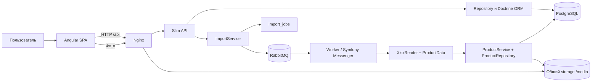
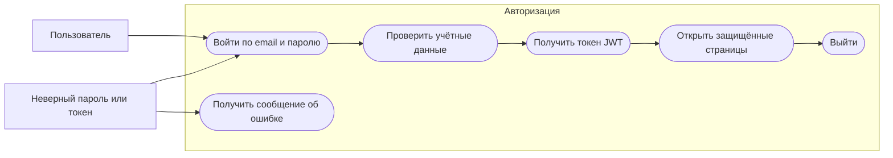
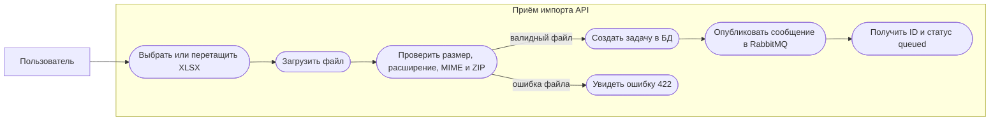
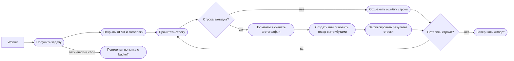
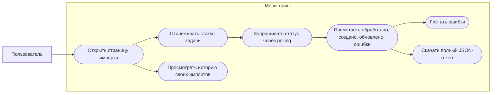
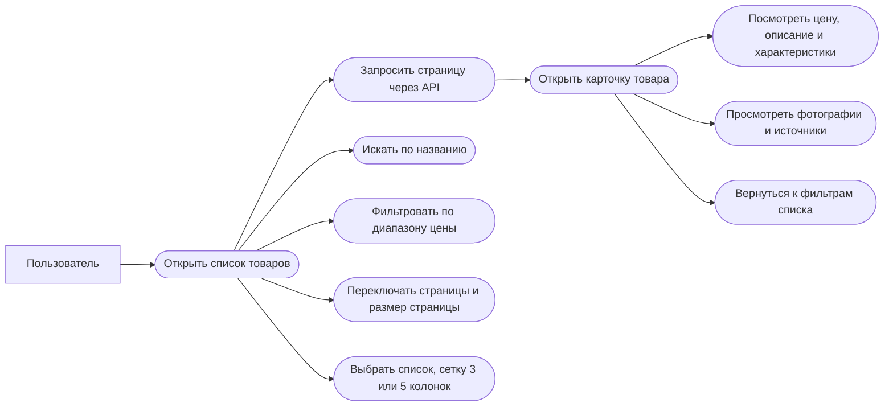
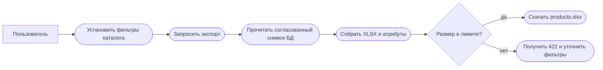
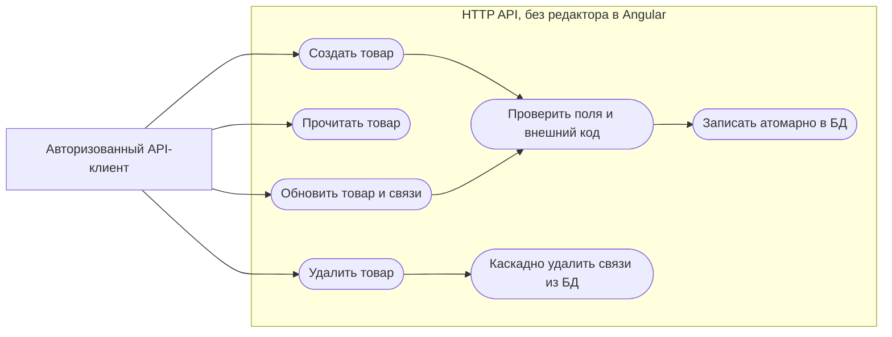
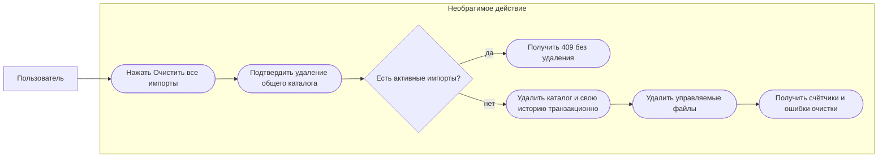
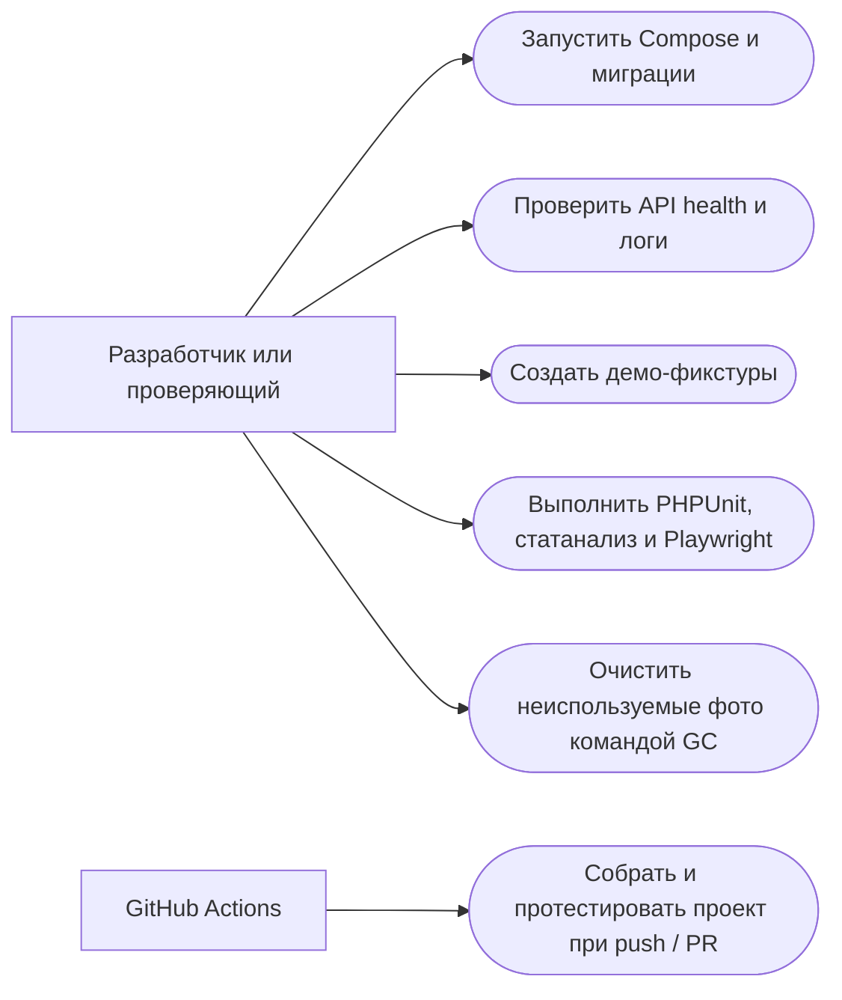

# Каталог товаров — асинхронный импорт и экспорт XLSX

> Тестовое приложение на **Slim 4 + Doctrine ORM + PostgreSQL 16** и **Angular 21 + NgRx**, с фоновым импортом через **Symfony Messenger / RabbitMQ**. Интерфейс, документация и бизнес-правила ориентированы на исходное тестовое задание (`docs/TASK.md`).

**Навигация:** [Запуск](#быстрый-запуск-через-docker) · [Проверка работоспособности](#проверка-после-установки) · [Функции](#возможности) · [Архитектура](#архитектура-и-движение-данных) · [API](#http-api) · [Use case](#диаграммы-вариантов-использования-use-case) · [Структура](#полная-иерархия-и-назначение-файлов) · [Справочник функций](#справочник-именованных-функций-и-методов) · [Тесты](#тестирование) · [Соответствие ТЗ](#соответствие-исходному-тз).

## Быстрый запуск через Docker

### Требования к компьютеру

- Docker Desktop или Docker Engine с **Docker Compose v2**; Docker Engine должен быть запущен.
- Git — только для клонирования репозитория. **PHP, Composer, Node.js и PostgreSQL локально не нужны**.
- Свободный порт **8080** или другой выбранный `APP_PORT`; доступ в интернет для начального скачивания Docker-образов и зависимостей.

### Установка с нуля

1. Склонировать репозиторий и перейти в его корень (там находятся `compose.yaml` и `setup.sh`). Можно также распаковать ZIP в пустую папку.
2. **До первого старта** создать `.env` на основе `.env.example` и заменить как минимум `ADMIN_EMAIL`, `ADMIN_PASSWORD`, `DB_PASSWORD`, `RABBITMQ_PASSWORD`. Пароль пользователя должен содержать не менее 12 символов. Для локального демонстрационного запуска разрешены значения из примера, но не для публичного сервера. Для `DB_PASSWORD` и `RABBITMQ_PASSWORD` используйте буквы, цифры и подчёркивания: они подставляются в URL без дополнительного кодирования.
3. Выполнить `sh setup.sh` из корня проекта. Если `.env` отсутствует, скрипт автоматически скопирует пример; при значении `JWT_SECRET=replace_...` создаст случайный ключ.
4. Дождаться успешного завершения команды и открыть **http://localhost:8080** (или выбранный порт).
5. Авторизоваться под `ADMIN_EMAIL` / `ADMIN_PASSWORD` из `.env`. При неизменённых демонстрационных значениях — `admin@example.com` / `CatalogDemo2026!`.
6. Перейти на страницу «Импорт», выбрать `examples/products.xlsx`, загрузить файл и проследить за статусом. В исходном образце **40 строк товаров**. При завершении откройте список и карточку.

```bash
# Команды выполняются из корня репозитория
cp .env.example .env         # только при первой установке; заполнить секреты
sh setup.sh                  # build + запуск с ожиданием healthcheck

docker compose ps            # состояние пяти сервисов
docker compose logs -f app worker nginx
```

**Внимание:** при повторном развёртывании сохраняйте существующий `.env`, иначе учётные данные и JWT-секрет могут не совпасть с действующей системой. `app:user` создаёт пользователя при отсутствии, но не меняет пароль уже существующего пользователя. Не публикуйте `.env` в Git.

### Что делает запуск

`setup.sh` проверяет доступность Docker, готовит `.env`, собирает PHP-приложение и Nginx со статическим Angular, затем поднимает стек и ожидает готовности сервисов. `docker/entrypoint.sh` выполняет миграции и создание начального пользователя перед стартом PHP-FPM. Worker запускается отдельно. PostgreSQL, RabbitMQ и файлы картинок/загрузок используют именованные Docker-тома.

| Контейнер | Назначение | Доступ |
| --- | --- | --- |
| `db` | PostgreSQL 16, данные каталога и задач | Только внутри Docker-сети |
| `rabbitmq` | Очередь заданий импорта по AMQP | Только внутри Docker-сети |
| `app` | Slim, Doctrine, миграции, HTTP API через PHP-FPM | Через `nginx` |
| `worker` | Приём сообщений Messenger и обработка XLSX | Фоновый процесс |
| `nginx` | Angular SPA, API reverse-proxy, выдача медиа | `localhost:${APP_PORT:-8080}` |

### Частые операции

```bash
make up                     # сборка и запуск
make down                   # остановка, данные остаются в volumes
make logs                   # логи API / worker / nginx
make check                  # PHPUnit + PHPStan + PHP CS Fixer
make fixtures               # три демонстрационных товара со связями

docker compose ps
docker compose logs --tail=100 worker
docker compose exec app php bin/console app:health
docker compose exec app php bin/console migrations:status
docker compose exec app php bin/console app:gc
```

Если порт 8080 занят, замените `APP_PORT=8080` в `.env`, например на `APP_PORT=8088`, затем повторите `sh setup.sh`. **Не используйте** `docker compose down -v` при обновлении: команда удаляет тома с БД, заданиями и фотографиями. Обычный `docker compose down` данные сохраняет. Сброс каталога в интерфейсе удаляет данные приложения; он тоже необратим.

### Без Docker (для разработки)

Нужны PHP **8.3** с расширениями из `backend/composer.json`, в частности `pdo_pgsql`, `pdo_sqlite`, `amqp`, `bcmath`, `curl`, `zip`, `gd`, `mbstring`, XML, а также Composer 2, Node.js **24**, работающие PostgreSQL и RabbitMQ. Заполните `.env` и задайте доступные с локальной машины `DATABASE_URL`, `MESSENGER_TRANSPORT_DSN`, `STORAGE_PATH`; примеры адресов приведены в `.env.example`. Затем:

```bash
cd backend
composer install
php bin/console migrations:migrate --no-interaction
php bin/console app:user --no-interaction
php -S 127.0.0.1:8080 -t public bin/router.php
# В отдельном терминале из backend/:
php bin/worker.php
# Для production-статики из frontend/:
npm ci && npm run build
# Для Angular dev-server: из frontend/ npm start, прокси /api указан в proxy.conf.json
```

Для нативного запуска нужно согласовать `STORAGE_PATH`, адрес API и права на каталоги `uploads/`, `media/`; режим без Docker предусмотрен для локальной разработки, **основной способ проверки — Compose**.

## Проверка после установки

1. `docker compose ps` показывает здоровые `db`, `rabbitmq`, `app`, `nginx` и работающий `worker`.
2. `GET http://localhost:8080/api/health` возвращает `status: ok` и `database: ok`.
3. Вход и защита страниц работают: до входа каталог переводит на `/login`.
4. Загрузить `examples/products.xlsx` через `/import`; API загрузки должен вернуть **202 Accepted**, а состояние — меняться без удержания открытого запроса.
5. После завершения — 40 товаров, товары открываются в карточке, доп. атрибуты и доступные загруженные фотографии отображаются.
6. Повторить импорт того же файла: существующие товары **обновляются**, новые дубликаты по `external_code` не создаются.
7. Проверить поиск, цену от/до, переход на следующую страницу, экспорт, загрузку JSON-отчёта.
8. **В тестовой БД** проверить очистку каталога после подтверждения и повторную загрузку. Функция удаления воздействует на общий каталог, а не только на товары конкретного пользователя.

Внешние изображения из файла загружаются **во время импорта**. Недоступность сторонних URL даёт предупреждения, а не означает отсутствие импорта товара. Для полноценного подтверждения загрузки файлов требуется тест с реально доступными URL или контролируемым HTTP-сервером.

## Возможности

| Модуль | Поведение |
| --- | --- |
| Вход | Логин, JWT с временем жизни один час, guard страниц, Bearer-interceptor, обработка 401 |
| Импорт | Выбор/перетаскивание XLSX, валидация, постановка в очередь, независимый worker, прогресс и история |
| Парсер | Первый лист, сопоставление полей по русским заголовкам, потоковое чтение XML, поддержка shared/inline strings |
| Запись | Upsert по `external_code`, транзакции, атрибуты `Доп. поле*`, отдельные сущности изображений |
| Фотографии | Ограничение размера/форматов, проверка публичных HTTP(S)-адресов, SHA-256 имена, дедупликация, предупреждения при сбое |
| Ошибки | Невалидные строки не останавливают остальные, постраничные ошибки, скачиваемый полный JSON-отчёт |
| Список | `GET /api/products` с серверной пагинацией, поиском, диапазоном цен, thumbnail, переключателем списка / 3 / 5 колонок |
| Карточка | Основные поля, скидка, характеристики, галерея, исходные ссылки изображений |
| Экспорт | XLSX по текущим фильтрам, ограничение объёма и потоковая сборка |
| Управление | CRUD API для товаров, фикстуры, очистка общего каталога по подтверждению, сборка неиспользуемых медиа |
| Качество | PHPUnit, PHPStan, PHP CS Fixer, Playwright, Angular typecheck / форматирование, OpenAPI и CI |

### Правила преобразования исходного Excel

Используется первый лист таблицы. В файле-примере 50 непустых именованных столбцов и 40 товарных строк. Поля передаются следующим образом:

| XLSX | База / API |
| --- | --- |
| `Внешний код` | `products.external_code`, уникальный ключ для upsert |
| `Наименование` | `products.name` |
| `Описание` | `products.description` |
| `Цена: Цена продажи` | `products.price` |
| `Закупочная цена` | `products.purchase_price` — дополнительное поле для расчёта |
| Рассчитывается | `products.discount = (price - purchase_price) / price × 100` |
| Все столбцы `Доп. поле*` с заполненными значениями | `product_attributes.key` + `product_attributes.value` |
| `Доп. поле: Ссылки на фото` | Набор URL для `product_images.url` и загруженных файлов `product_images.path` |

Стоимость хранится как строка десятичного числа с двумя знаками после точки (без двоичного `float` в расчёте денег). Если продажная цена равна нулю, строка невалидна. Скидка отражает **формулу ТЗ**, даже если по обычной бизнес-терминологии это скорее наценка/маржа, а не маркетинговая скидка.

### Ограничения и намеренное поведение

- XLSX не больше **10 МиБ**, до **10 000** товарных строк, **200** колонок; ограничения распакованного ZIP — 100 МиБ / 2000 записей. Формат `.xls` не поддерживается.
- До **30 URL изображений** на товар; скачиваемый файл — не больше **5 МиБ**, JPEG/PNG/WebP/GIF. Поддерживается IPv4 и публичные HTTP(S) с портами 80/443; нестандартные порты и локальные адреса блокируются.
- Не более **195** атрибутов на товар, цена продажи должна быть положительной. Ошибки внешних изображений могут оставлять товар без фото, сохраняя предупреждение.
- Для существующего товара при частичном сбое загрузки новой галереи сохраняются доступные старые фотографии; пустой список URL намеренно очищает галерею.
- Экспорт ограничен 10 000 товарами, 200 столбцами, 10 МиБ ZIP и 100 МиБ распакованных данных.
- У одной задачи сохраняются состояние, число попыток, отложенная повторная обработка и квитанции успешно обработанных строк. Worker может восстановить задания после сбоя очереди. Предельное число запусков задачи — четыре.
- На странице импорта отображаются ошибки и прогресс; на странице конкретного товара их нет. **В исходном ТЗ эти два пункта формально указаны в разделе карточки**, поэтому буквальное расположение отличается, хотя функциональность присутствует.
- В интерфейсе нет редактора CRUD: создание/изменение/удаление отдельных товаров доступно **через HTTP API** (UI-карточка предназначена для просмотра).

## Архитектура и движение данных



**Разделение ответственности:** Slim-контроллеры принимают и проверяют запрос, сервисы выполняют бизнес-логику, репозитории формируют запросы к БД; worker не зависит от длительности исходного HTTP-запроса. Import jobs и квитанции строк позволяют пропускать уже подтверждённые строки при возобновлении. Записи товара и связей обёрнуты в транзакции; скачивание изображений выполняется до записи и не является частью DB-транзакции.

**Сущности:** `products (1) → (N) product_attributes`, `products (1) → (N) product_images`; `users (1) → (N) import_jobs (1) → (N) import_rows`. `rate_limits` хранит счётчики обращений. Удаление товара каскадно убирает записи атрибутов/изображений; очистку физических файлов выполняет специальный путь очистки каталога или GC для сирот.

## HTTP API

Для большинства `/api/*` необходимо `Authorization: Bearer <JWT>`. Исключения — `/api/health` и `/api/auth/login`. Спецификация: [`backend/openapi.json`](backend/openapi.json), доступна также по `/openapi.json`.

| Метод | Endpoint | Действие / особенности |
| --- | --- | --- |
| `POST` | `/api/auth/login` | email + password → JWT |
| `GET` | `/api/health` | Доступность БД / таблицы пользователей |
| `GET` | `/api/products` | `page`, `limit`, `name`, `price_min`, `price_max`; серверная пагинация |
| `GET` | `/api/products/{id}` | Товар, все атрибуты и изображения |
| `POST` | `/api/products` | Создание товара, проверка уникальности кода |
| `PUT` | `/api/products/{id}` | Обновление товара и связанных коллекций |
| `DELETE` | `/api/products/{id}` | Удаление товара |
| `GET` | `/api/products/export` | XLSX с текущими фильтрами |
| `POST` | `/api/imports` | multipart `file`: асинхронная задача, ответ 202 |
| `GET` | `/api/imports` | Последние 20 импортов текущего пользователя |
| `GET` | `/api/imports/{id}` | Статус, счётчики, первые 100 ошибок |
| `GET` | `/api/imports/{id}/errors` | Пагинация всех ошибок (`page`, `limit`) |
| `GET` | `/api/imports/{id}/report` | Полный JSON-отчёт файлом |
| `DELETE` | `/api/imports` | Очистка **общего каталога** и своей истории, JSON `{ "confirm": "CLEAR_CATALOG" }` |

У задач импорта есть права владельца: другой пользователь не должен получать чужие статусы и отчёты. Ошибки валидации возвращаются с HTTP 422; отсутствие ресурсов — 404; коллизия кода или очистка при активных задачах — 409; превышение лимита — 429; ошибки сервера — 500. При импортировании сам HTTP-запрос не дожидается завершения Excel.

## Диаграммы вариантов использования (use case)

Ниже — **Mermaid-диаграммы вариантов использования**: овалы показывают действия, прямоугольники — границы подсистем, подписи стрелок раскрывают связи. В отличие от PlantUML, Mermaid отображается непосредственно в GitHub README. Каждая диаграмма небольшая, с русскими названиями и отдельной областью ответственности; технические операции worker вынесены в отдельные схемы.

### UC-01. Вход и доступ к страницам



### UC-02. Создание задания на импорт



### UC-03. Обработка XLSX рабочим процессом



### UC-04. Контроль выполнения и отчёт об ошибках



### UC-05. Просмотр и поиск товаров



### UC-06. Экспорт каталога



### UC-07. Управление отдельными товарами через API



### UC-08. Очистка каталога



### UC-09. Администрирование, здоровье и тестирование



## Тестирование

### Встроенные проверки

```bash
make check                  # серверные PHPUnit, PHPStan, CS Fixer
make fixtures               # фикстуры products, product_attributes, product_images
cd frontend && npm ci && npm run typecheck && npm run build && npm run format:check
cd ../e2e && npm ci && npx playwright install chromium firefox webkit && npm test
```

**Осторожно:** `e2e/tests/catalog.spec.ts` использует настоящий API и **удаляет все товары и собственную историю импортов** в одном из сценариев. Запускайте его только на специально созданном тестовом стенде, не на рабочей БД. `e2e/tests/ui-glass.spec.ts` использует перехват запросов и тестовые ответы для проверки интерфейса; его успешное прохождение не доказывает интеграцию с PostgreSQL и RabbitMQ.

| Набор | Назначение |
| --- | --- |
| `backend/tests/ValidationTest.php` | Цены, ограничители, формат/сериализация сообщений |
| `backend/tests/ProductTest.php` | CRUD, уникальность, транзакции, пагинация, фильтры, связи, экспортные батчи |
| `backend/tests/ImportTest.php` | Исходный XLSX из ТЗ, повторный импорт, ошибки строк, возобновление, round-trip экспорта |
| `backend/tests/ImageStorageTest.php` | MIME изображений, размер, дедупликация, сброс кэша |
| `backend/tests/ApiTest.php` | Авторизация, ограничения, отчёты, reset, доступ пользователей, rollback |
| `backend/tests/ReliabilityTest.php` | Повторные попытки, queue-сообщения, отчёты, потоковый Excel, некорректные XML |
| `e2e/tests/catalog.spec.ts` | Full-stack UI + API + БД + очередь в Chromium |
| `e2e/tests/ui-glass.spec.ts` | Мокированные UI-сценарии и проверка отзывчивости на трёх движках |

В `.github/workflows/ci.yml` на `push` и `pull_request` настроен запуск полного Compose, проверок PHP и Playwright. **Статус удалённого CI и Docker-прохождение должны быть подтверждены зелёным запуском Actions**; факт наличия workflow не подменяет запуск. В рамках подготовки этого README выполнялась статическая проверка исходников и `php -l`, но не полноценный контейнерный E2E-прогон.

### Рекомендуемые дополнительные тесты

1. Конкурентный импорт двух файлов с одинаковым `external_code`: отсутствие дублей, deadlock и потерянных обновлений.
2. Принудительный останов worker **после commit строки, но до ack**: повтор доставки не создаёт дубликаты и не портит отчёт.
3. Выключение RabbitMQ на приёме файла и при публикации: задача остаётся `queued` и восстанавливается.
4. Отдельный mock HTTP-сервер изображений: редиректы, DNS rebinding, private IP, пустой `Content-Type`, битые байты, 5 МиБ, таймауты.
5. Реальная многопользовательская очистка и ограничения прав доступа; особенно общность каталога при разной истории задач.
6. Большой XLSX на границах 10 000 строк / 200 столбцов и профилирование памяти/времени на ограниченных контейнерных ресурсах.
7. Проверка всех трёх браузерных движков, клавиатурного управления галереей и screen-reader accessibility.
8. Регрессионный тест CI в чистом GitHub runner и повторной установки `setup.sh` с сохранением данных.

## Соответствие исходному ТЗ

| Раздел ТЗ | Подтверждение в коде | Замечание для проверки |
| --- | --- | --- |
| Slim / Doctrine / PostgreSQL | `backend/src/Application.php`, `Support/Database.php`, ORM Entity, migrations | Проверить свежую миграцию в Docker |
| Три таблицы товара, атрибутов, фото | `Entity/*`, миграция `Version20261030000100.php` | Дополнительные технические таблицы допустимы |
| XLSX → БД + upsert + отчёт | `XlsxReader`, `ImportProcessor`, `ProductRepository`, `ImportRepository` | Внешние URL фотографий зависят от сети |
| Асинхронность Messenger / RabbitMQ | `ImportQueue`, `ImportMessage`, `worker.php` | Нужен живой интеграционный прогон |
| Список: пагинация, фильтры, NgRx / async pipe | `ProductRepository`, `products.store.ts`, `products.effects.ts`, `products.page.*` | Пагинация серверная |
| Карточка: поля, атрибуты, фото | `product.page.*`, `product-gallery.*` | Прогресс и отчёт импорта размещены на странице импорта, **не в карточке** |
| Backend слои, транзакции, MIME | `Controller`, `Service`, `Repository`, `ImportService` | Фото скачиваются вне DB-транзакции |
| Docker, multi-stage, env | `compose.yaml`, `docker/*.Dockerfile`, `.env.example` | Нужна проверка build на чистом хосте |
| Rate-limit, health, OpenAPI | `RateLimitRepository`, `Application`, `backend/openapi.json` | Rate-limit на импорт и вход |
| Tests / fixtures / e2e | `backend/tests`, `e2e/tests`, `app:fixtures` | Оценивать по воспроизводимым командам |
| UI-kit / guard / interceptor / lazy / strict | Angular Material, `app.routes.ts`, `auth.interceptor.ts`, `tsconfig.json` | Проверить mobile UX и доступность |
| PHPStan / CS Fixer / GitHub Actions | `phpstan.neon`, `.php-cs-fixer.php`, `.github/workflows/ci.yml` | CI должен реально завершаться успешно |

**Граница требований:** исходное ТЗ не требует корзину, остатки, заказы, редактирование товара через UI или роли администратора. В проекте это не заявляется. Дополнительный экспорт и очистка каталога — реализованные расширения. Из текста ТЗ прогресс импорта и отчёт ошибок формально относятся к карточке товара; размещение их на странице импорта — осознанное UX-решение, но при буквальной оценке ТЗ это **два спорных пункта**.

## Полная матрица 56 пунктов ТЗ

Это **статическое сопоставление** требований с файлами, не выдача сертификата о прохождении Docker/CI. «В исходниках» означает, что механизм обнаружен в коде; живые тесты рекомендуется повторить.

| № | Требование | Обнаружено в проекте | Статус оценки |
|---:|---|---|---|
| 01 | Таблица `product_attributes`: Поля `key` и `value` (формат ключ–значение) | `Entity/ProductAttribute.php` | В исходниках |
| 02 | Таблица `product_attributes`: Источник: столбцы xlsx с префиксом `"Доп. поле"` | `Service/XlsxReader.php` | В исходниках |
| 03 | Таблица `product_attributes`: Привязка к товару через внешний ключ | `migrations/Version20261030000100.php` | В исходниках |
| 04 | Таблица `product_images`: Поля `url` (исходная ссылка) и `path` (локальный путь) | `Entity/ProductImage.php` | В исходниках |
| 05 | Таблица `product_images`: При импорте изображения **скачиваются** по ссылке из файла | `Service/ImageDownloader.php` | Реализация есть; внешняя сеть не проверена |
| 06 | Таблица `product_images`: Привязка к товару через внешний ключ | `migrations/Version20261030000100.php` | В исходниках |
| 07 | Страница импорта товаров: Кнопка выбора и загрузки `.xlsx` файла | `frontend/src/app/pages/import.page.ts` | В исходниках |
| 08 | Страница импорта товаров: Парсинг файла → запись в БД | `Service/ImportProcessor.php` | В исходниках |
| 09 | Страница импорта товаров: Скачивание изображений и привязка к товарам | `Service/ProductService.php` | Реализация есть; внешняя сеть не проверена |
| 10 | Страница импорта товаров: Асинхронный импорт через очередь — Symfony Messenger + RabbitMQ/Kafka (не синхронный запрос) | `Service/ImportQueue.php` | В исходниках |
| 11 | Страница импорта товаров: Обработка ошибок импорта: невалидные строки не прерывают процесс, собираются в отчёт и возвращаются клиенту | `Repository/ImportRepository.php` | В исходниках |
| 12 | Страница импорта товаров: Повторный импорт: upsert по `external_code` — дубликаты не создаются | `Repository/ProductRepository.php` | В исходниках |
| 13 | Страница списка товаров: Загрузка товаров из API | `frontend/src/app/services/product.service.ts` | В исходниках |
| 14 | Страница списка товаров: Список с кликабельными элементами → переход на карточку товара | `frontend/src/app/pages/products.page.html` | В исходниках |
| 15 | Страница списка товаров: Серверная пагинация (`?page=&limit=`) — данные запрашиваются постранично, не client-side slice | `Repository/ProductRepository.php` | В исходниках |
| 16 | Страница списка товаров: Поиск и фильтрация по полям (`name`, диапазон `price`) | `Repository/ProductRepository.php` | В исходниках |
| 17 | Страница списка товаров: NgRx Store + Effects для списка товаров: | `frontend/src/app/state/products.store.ts` | В исходниках |
| 18 | Страница списка товаров: Компонент использует `async pipe` и `store.select()`, не прямой `.subscribe()` | `frontend/src/app/pages/products.page.ts` | В исходниках |
| 19 | Карточка товара: Все основные поля товара | `frontend/src/app/pages/product.page.html` | В исходниках |
| 20 | Карточка товара: Дополнительные атрибуты (`product_attributes`) | `frontend/src/app/pages/product.page.html` | В исходниках |
| 21 | Карточка товара: Изображения (`product_images`) | `frontend/src/app/components/product-gallery.component.ts` | В исходниках |
| 22 | Карточка товара: Индикатор прогресса импорта — polling статуса задачи или WebSocket | `frontend/src/app/pages/import.page.ts` | **Расхождение места в UI** |
| 23 | Карточка товара: Отображение отчёта об ошибках после импорта | `frontend/src/app/pages/import.page.ts` | **Расхождение места в UI** |
| 24 | Backend: Логика импорта (парсинг, скачивание изображений) — в отдельном Service-слое, не в контроллере | `backend/src/Service/ImportProcessor.php` | В исходниках |
| 25 | Backend: Репозиторий-паттерн: запросы к БД через отдельные Repository-классы | `backend/src/Repository/` | В исходниках |
| 26 | Backend: Контроллер только принимает запрос, делегирует, возвращает ответ | `backend/src/Controller/` | В исходниках |
| 27 | Backend: Транзакция на запись товара + атрибутов + изображений (атомарность) | `backend/src/Repository/ProductRepository.php` | В исходниках |
| 28 | Backend: Валидация входящего файла: тип MIME, размер, расширение | `backend/src/Service/ImportService.php` | В исходниках |
| 29 | Frontend: Для каждой сущности — отдельный Angular-сервис (`ProductService`, `ImportService`) — не прямой `HttpClient` в компонентах | `frontend/src/app/services/` | В исходниках |
| 30 | Frontend: TypeScript-интерфейсы для всех сущностей в `src/app/models/` (`Product`, `ProductAttribute`, `ProductImage`) | `frontend/src/app/models/` | В исходниках |
| 31 | Frontend: Роутинг в отдельном `app.routes.ts` или модульном routing-файле | `frontend/src/app/app.routes.ts` | В исходниках |
| 32 | Frontend: `NgRx Store + Effects` хотя бы для списка товаров (см. требования выше) | `frontend/src/app/state/products.effects.ts` | В исходниках |
| 33 | Frontend: `strict: true` в `tsconfig.json` | `frontend/tsconfig.json` | В исходниках |
| 34 | Сервис `app` — само приложение (PHP / Slim) | `compose.yaml: app` | Исходники/конфигурация есть; требуется запуск |
| 35 | Сервис `db` — база данных | `compose.yaml: db` | Исходники/конфигурация есть; требуется запуск |
| 36 | Сервис `nginx` — веб-сервер _(опционально)_ | `compose.yaml: nginx` | Исходники/конфигурация есть; требуется запуск |
| 37 | Брокер сообщений — `kafka` или `rabbitmq` | `compose.yaml: rabbitmq` | Исходники/конфигурация есть; требуется запуск |
| 38 | Multi-stage сборка Docker-образов | `docker/php.Dockerfile + nginx.Dockerfile` | Исходники/конфигурация есть; требуется запуск |
| 39 | `.env.example` с описанием всех переменных окружения | `.env.example` | В исходниках |
| 40 | Пагинация в списке товаров (`GET /api/products?page=1&limit=20`) | `Repository/ProductRepository.php` | В исходниках |
| 41 | Фильтрация и поиск по полям (`name`, диапазон `price`) | `Repository/ProductRepository.php` | В исходниках |
| 42 | Rate limiting на endpoint импорта | `Repository/RateLimitRepository.php` | В исходниках |
| 43 | Health check endpoint (`GET /api/health`) | `backend/src/Application.php` | В исходниках |
| 44 | Сидеры (fixtures) для всех трёх таблиц | `backend/bin/console` | В исходниках |
| 45 | Тесты CRUD-операций | `backend/tests/ProductTest.php` | В исходниках |
| 46 | e2e тесты | `e2e/tests/` | Исходники/конфигурация есть; требуется запуск |
| 47 | `README.md` с описанием проекта и инструкцией по запуску | `README.md` | В исходниках |
| 48 | `Makefile` или `.sh`-скрипт для быстрого развёртывания | `setup.sh / Makefile` | В исходниках |
| 49 | API описано через **Swagger / OpenAPI** | `backend/openapi.json` | В исходниках |
| 50 | Карточка товара и страница списка оформлены с использованием UI-кита (Material, Bootstrap, PrimeNG, Tailwind и т.п.) | `frontend/src/app/pages/products.page.html` | В исходниках |
| 51 | HTTP-interceptor на фронте: добавляет заголовки авторизации или обрабатывает глобальные ошибки (401/500) | `frontend/src/app/services/auth.interceptor.ts` | В исходниках |
| 52 | Lazy loading Angular-модулей или standalone-компонентов | `frontend/src/app/app.routes.ts` | В исходниках |
| 53 | Аутентификация: login-страница, защита маршрутов через `CanActivate` guard, JWT или сессия | `frontend/src/app/services/auth.service.ts` | В исходниках |
| 54 | PHPStan (level ≥ 5) настроен и не выдаёт ошибок (`phpstan.neon`) | `backend/phpstan.neon` | Исходники/конфигурация есть; требуется запуск |
| 55 | PHP CS Fixer или phpcs настроены (`phpcs.xml` / `.php-cs-fixer.php`) | `backend/.php-cs-fixer.php` | Исходники/конфигурация есть; требуется запуск |
| 56 | GitHub Actions: прогон тестов или сборка образа при `push` | `.github/workflows/ci.yml` | Исходники/конфигурация есть; требуется запуск |

**Итог по статической сверке:** найдено соответствие по основным техническим механизмам; **2 пункта (22–23)** отличаются расположением в UI, **2 пункта (5 и 9)** требуют теста реальной загрузки изображений; проверка полной сборки, тестов, CI и запуска контейнеров остаётся обязательной. Критически важный блок — импорт + БД + очередь — должен быть подтверждён на чистом стенде перед сдачей.

## Рекомендации по безопасности и сопровождению

- Обязательно менять стандартные пароли и JWT-секрет перед публичным развёртыванием; не коммитить `.env` и сохранённые данные из томов.
- Интерфейс представляет однотипного авторизованного пользователя. Отдельных ролей/административных разрешений на глобальную очистку сейчас нет. Для эксплуатации с несколькими аккаунтами следует добавить RBAC/разрешение `catalog:reset`.
- Системная очистка файлов после DB commit не может быть частью той же ACID-транзакции. Число `cleanup_failed` нужно учитывать и удалять сироты безопасным GC.
- Rate-limit для импорта хранится в PostgreSQL; это защита от частоты запросов, а не квота на дисковое пространство/внешний трафик. Для публичного окружения нужны эксплуатационные ограничения и мониторинг.
- JWT в `sessionStorage` делает сеанс зависимым от безопасности JS-контекста; для продакшена стоит оценить HttpOnly cookie и механизм отзыва сессий.
- Не использовать демонстрационный сервис и фикстуры с реальными секретами. Планировать резервное копирование PostgreSQL и тома `catalog-storage` перед обновлениями.

## Полная иерархия и назначение файлов

В дереве перечислены **все файлы исходного проекта, сохранённые в финальном архиве**; после тире — назначение каждого файла. Конфиденциальный `.env` и генерируемые папки зависимостей здесь отсутствуют.

```text
product-importer/
.dockerignore  —  Исключения из контекста Docker-сборки.
.env.example  —  Публичный шаблон переменных окружения с комментариями.
.github/
  workflows/
    ci.yml  —  GitHub Actions: проверка форматирования, сборка Compose, PHPUnit, PHPStan, CS Fixer и Playwright на 3 движках.
.gitignore  —  Исключения Git для секретов, зависимостей и артефактов.
Makefile  —  Сокращённые команды запуска, анализа, фикстур и тестирования.
README.md  —  Основная документация, архитектура, API, схемы и реестр файлов/функций.
backend/
  .php-cs-fixer.php  —  Стандарты форматирования и анализ стиля PHP.
  bin/
    console  —  CLI-команды migrations, app:user, app:health, app:fixtures и app:gc.
    router.php  —  Роутер встроенного PHP-сервера для API, SPA и медиа.
    worker.php  —  Цикл RabbitMQ worker: polling, восстановление, ack/reject, останов.
  bootstrap.php  —  Composer autoload, загрузка окружения, создание Runtime.
  composer.json  —  PHP-зависимости Slim/Doctrine/Messenger и команды качества.
  composer.lock  —  Фиксация точных версий Composer-пакетов.
  migrations/
    Version20261030000100.php  —  Базовые таблицы products/attributes/images/users/jobs/rows/limits.
    Version20261030000200.php  —  Индексы для thumbnail, истории и rate limits.
    Version20261030000300.php  —  Попытки, задержки и метки публикации импортов.
    Version20261030000400.php  —  pg_trgm, GIN-индекс поиска имени и hash-индекс URL.
  migrations.php  —  Путь и namespace миграций Doctrine.
  openapi.json  —  Машиночитаемая OpenAPI 3.0.3-спецификация.
  phpstan.neon  —  Статическая проверка PHPStan level 7.
  phpunit.xml  —  Конфигурация PHPUnit и подключение тестового bootstrap.
  public/
    index.php  —  Единственная HTTP-точка входа Slim.
  src/
    Application.php  —  Маршрутизация Slim, middleware, обработка ошибок, health и auth endpoint.
    Controller/
      ImportController.php  —  HTTP endpoints создания, мониторинга, ошибок, отчёта и очистки импортов.
      ProductController.php  —  HTTP endpoints CRUD, списка, карточки и экспорта товара.
    Entity/
      Product.php  —  Doctrine сущность Product, отношения attributes/images и сериализация.
      ProductAttribute.php  —  Doctrine сущность дополнительного поля (key/value).
      ProductImage.php  —  Doctrine сущность URL и локального пути изображения.
    Message/
      ImportMessage.php  —  Минимальное сообщение очереди с ID импорта.
      ImportSerializer.php  —  JSON-сериализация Messenger Envelope и отбраковка неверных сообщений.
    Middleware/
      AuthMiddleware.php  —  Защита API Bearer JWT (кроме health/login).
    Repository/
      CatalogResetRepository.php  —  SQL-транзакция удаления каталога и истории инициатора.
      ImportRepository.php  —  Хранение import jobs, ошибок строк, прогресса и политики retry.
      ProductRepository.php  —  Doctrine-запросы каталога, пагинация, upsert, транзакции и связи.
      RateLimitRepository.php  —  Персистентный rate limiting с атомарным SQL upsert.
      UserRepository.php  —  Поиск, проверка и создание аккаунта.
    Runtime.php  —  Объект композиции и создание сервисов/репозиториев.
    Service/
      AuthService.php  —  Вход пользователя и верификация JWT.
      CatalogResetService.php  —  Оркестрация очистки БД + безопасное удаление управляемых файлов.
      ExportService.php  —  Потоковая генерация XLSX из каталога с проверкой лимитов.
      ExportStringTable.php  —  Временная дисковая таблица строк sharedStrings для XLSX экспорта.
      ImageDownloader.php  —  HTTP-загрузчик фото с SSRF-защитой, redirect и ограничением объёма.
      ImageFetcher.php  —  Контракт загрузчика фото для подмены в тестах.
      ImageStorage.php  —  Проверка MIME/формата и SHA-256 запись фотографии.
      ImportProcessor.php  —  Обработка задания: чтение строк, ошибки, upsert, квитанции и retry.
      ImportQueue.php  —  Настройка Messenger AMQP transport и публикация сообщения.
      ImportReportService.php  —  Потоковая сборка полного JSON-отчёта задачи.
      ImportService.php  —  Проверка и сохранение загруженного XLSX, постановка задачи.
      PreparedImages.php  —  DTO подготовленных изображений и предупреждений.
      ProductData.php  —  Валидация и нормализация товара, расчёт скидки Decimal.
      ProductService.php  —  Бизнес-оркестрация сохранения товара и получения изображений.
      XlsxReader.php  —  Потоковый парсер OOXML первого листа, заголовков и значений.
    Support/
      ApiException.php  —  Ошибка API с явным HTTP-кодом.
      CatalogLock.php  —  PostgreSQL advisory locks для каталога, задания и очистки.
      Config.php  —  Чтение env и путь к storage.
      Database.php  —  Создание Doctrine DBAL и EntityManager.
      Json.php  —  Единый JSON HTTP-ответ.
      ReadSnapshot.php  —  Согласованный read-only repeatable-read snapshot PostgreSQL.
      StreamWriter.php  —  Полная запись данных в поток с обработкой ошибок.
  tests/
    ApiTest.php  —  Тесты HTTP API, логина, проверок доступа и общей очистки.
    DatabaseTestCase.php  —  База интеграционных PHPUnit-тестов и изоляция данных.
    ImageStorageTest.php  —  Тесты загрузки/проверки/дедупликации изображений.
    ImportTest.php  —  Тесты импорта исходного XLSX, повторного запуска и round-trip.
    ProductTest.php  —  Тесты ORM CRUD, связей, поиска, транзакций и пагинации.
    ReliabilityTest.php  —  Тесты восстановления очереди, ошибок и потоковой обработки XLSX.
    ValidationTest.php  —  Тесты проверки цены, сообщений очереди и URL.
  var/
    .gitkeep  —  Сохраняет пустую директорию для нативного локального storage.
compose.yaml  —  Пять сервисов Docker, health checks и именованные тома.
docker/
  entrypoint.sh  —  Миграции и создание пользователя перед стартом PHP-FPM.
  nginx.Dockerfile  —  Multi-stage сборка Angular Node 24 → Nginx.
  nginx.conf  —  Раздача SPA/media и проксирование /api в PHP-FPM.
  php.Dockerfile  —  Multi-stage PHP 8.3 + Composer зависимости и PHP extensions.
  php.ini  —  Параметры PHP для импорта и загрузки файлов.
docs/
  TASK.md  —  Копия исходных требований для воспроизводимой сверки.
e2e/
  package-lock.json  —  Зафиксированные версии Playwright.
  package.json  —  Playwright-зависимости и npm test.
  playwright.config.ts  —  Три браузерных проекта, таймауты и параметры запуска.
  tests/
    catalog.spec.ts  —  Шесть реальных браузерных сценариев на живых API/БД/очереди; удаляет данные.
    ui-glass.spec.ts  —  UI-сценарии с моками API для layout, загрузки, галереи, фильтров и отчётов.
examples/
  products.xlsx  —  Исходный Excel из задания, 40 продуктов, 50 колонок; контрольный образец.
frontend/
  .prettierrc.json  —  Правила Prettier.
  angular.json  —  Angular CLI build/serve конфигурация.
  package-lock.json  —  Фиксация JS пакетов.
  package.json  —  Angular/Material/NgRx зависимости и npm scripts.
  proxy.conf.json  —  Прокси API при запуске Angular dev-server.
  src/
    app/
      app.component.html  —  Навигация, header и router-outlet.
      app.component.ts  —  Корневой компонент: auth + общие ошибки.
      app.routes.ts  —  Lazy standalone роутинг и guard.
      components/
        copy-code.component.css  —  Стили компактной кнопки.
        copy-code.component.html  —  Кнопка и состояние копирования.
        copy-code.component.ts  —  Копирование внешнего кода товара в буфер.
        product-gallery.component.css  —  Стили и адаптив галереи.
        product-gallery.component.html  —  Галерея и диалог просмотра фотографий.
        product-gallery.component.ts  —  Контроллер галереи, текущий кадр, навигация и zoom.
        product-thumbnail.component.css  —  Стили картинки/заглушки.
        product-thumbnail.component.html  —  Разметка preview/placeholder.
        product-thumbnail.component.ts  —  Миниатюра товара с fallback по ошибке картинки.
      models/
        import-job.ts  —  Интерфейсы статусов, ошибок, истории импорта, подписи статусов.
        product.ts  —  Интерфейсы Product, ProductAttribute, ProductImage, фильтры и ответ списка.
      pages/
        import.page.css  —  Локальная стилизация страницы импорта.
        import.page.html  —  Разметка загрузки, прогресса, истории и подтверждения очистки.
        import.page.ts  —  Состояние страницы, drag/drop, загрузка, polling, история, отчёты, очистка.
        login.page.html  —  HTML формы входа.
        login.page.ts  —  Вход и отображение ошибок формы.
        product.page.css  —  Адаптивная двухколоночная карточка и мобильный layout.
        product.page.html  —  Разметка карточки, данных, галереи и источников.
        product.page.ts  —  Загрузка карточки, безопасная ссылка назад, атрибуты.
        products.page.css  —  Адаптивные сетки, карточки и элементы списка.
        products.page.html  —  Разметка списка/сетки, поиска, фильтров и пагинатора.
        products.page.ts  —  NgRx-каталог, фильтры, пагинация, переключатель вида, экспорт.
      services/
        auth.interceptor.ts  —  Bearer JWT, 401 logout, глобальные сетевые ошибки.
        auth.service.ts  —  Сессия, login/logout и sessionStorage JWT.
        catalog-preferences.service.ts  —  Сохранение вида каталога в браузере.
        file-download.ts  —  Скачивание Blob как файла.
        import.service.ts  —  HTTP импорта, статусы, polling, отчёты, история, reset.
        product.service.ts  —  HTTP список/карточка/экспорт и сериализация фильтров.
        scroll-position.ts  —  Высота закреплённого header для прокрутки.
      state/
        products.effects.ts  —  NgRx Effect обращения к ProductService с отменой/reset.
        products.store.ts  —  NgRx actions, reducer и selectors для каталога.
    index.html  —  HTML-оболочка Angular SPA.
    main.ts  —  Bootstrap Angular, роутер, interceptor, Store/Effects, русская локаль.
    styles.css  —  Глобальные темы, типографика, компоненты и адаптивные правила.
  tsconfig.app.json  —  Конфигурация сборки TypeScript frontend.
  tsconfig.json  —  TS strict и настройки компилятора.
setup.sh  —  Инициализация .env и JWT-секрета, build и запуск Compose.
```

## Справочник именованных функций и методов

Ниже указаны **все именованные PHP-методы в прикладном коде** и **именованные методы Angular-сервисов, страниц и компонентов**. Для конструктора `__construct` подразумевается инициализация зависимостей/состояния, для `__destruct` — освобождение ресурсов; анонимные callbacks `map`, `switchMap`, `catchError`, `on`, `effect` описаны по назначению вызывающих методов и модулей.

### Backend — бизнес-логика и инфраструктура

#### `backend/src/Application.php`

- `create()` — собирает Slim-приложение, routes и middleware, настраивает login, health и JSON ошибки.

#### `backend/src/Controller/ImportController.php`

- `__construct()` — инициализирует сущность, внедряет зависимости и/или сохраняет поля объекта.
- `create()` — принимает XLSX, применяет rate limit, возвращает ID задачи и HTTP 202.
- `status()` — показывает состояние и прогресс по ID владельца.
- `errors()` — возвращает страницу ошибок импорта.
- `report()` — отдаёт скачиваемый полный JSON отчёт.
- `recent()` — список последних задач владельца.
- `clear()` — проверяет confirm и инициирует очистку каталога.

#### `backend/src/Controller/ProductController.php`

- `__construct()` — инициализирует сущность, внедряет зависимости и/или сохраняет поля объекта.
- `index()` — выдаёт страницу каталога по фильтрам.
- `show()` — показывает товар и отношения.
- `create()` — проверяет входные данные и создаёт товар.
- `update()` — меняет существующий товар.
- `delete()` — удаляет по ID.
- `export()` — генерирует и возвращает XLSX.

#### `backend/src/Entity/Product.php`

- `__construct()` — создаёт товар по внешнему коду.
- `toArray()` — сериализует поля и при необходимости связи.

#### `backend/src/Entity/ProductAttribute.php`

- `__construct()` — инициализирует сущность, внедряет зависимости и/или сохраняет поля объекта.

#### `backend/src/Entity/ProductImage.php`

- `__construct()` — инициализирует сущность, внедряет зависимости и/или сохраняет поля объекта.

#### `backend/src/Message/ImportMessage.php`

- `__construct()` — инициализирует сущность, внедряет зависимости и/или сохраняет поля объекта.

#### `backend/src/Message/ImportSerializer.php`

- `decode()` — валидирует AMQP JSON и восстанавливает Messenger Envelope; битые сообщения отклоняются.
- `encode()` — сериализует ID задачи и redelivery stamp в JSON.

#### `backend/src/Middleware/AuthMiddleware.php`

- `__construct()` — инициализирует сущность, внедряет зависимости и/или сохраняет поля объекта.
- `process()` — проверяет Bearer JWT для защищённых /api и проставляет user_id.

#### `backend/src/Repository/CatalogResetRepository.php`

- `__construct()` — инициализирует сущность, внедряет зависимости и/или сохраняет поля объекта.
- `reset()` — удаляет каталог и историю инициатора в DB-транзакции, возвращает пути файлов.

#### `backend/src/Repository/ImportRepository.php`

- `snapshot()` — исполняет чтение в согласованном снимке БД.
- `__construct()` — инициализирует сущность, внедряет зависимости и/или сохраняет поля объекта.
- `create()` — создаёт новую queued-задачу с уникальным ID.
- `lockOwner()` — синхронизирует создание задачи по записи пользователя.
- `get()` — загружает задачу с проверкой владельца.
- `status()` — рассчитывает прогресс, количества и ограниченный массив ошибок.
- `errorCount()` — считает ошибки всех квитанций строк.
- `iterateErrors()` — потоково перебирает ошибки с limit и offset.
- `errors()` — обрабатывает пагинацию ошибок конкретной задачи.
- `beginAttempt()` — регистрирует старт очередной попытки с бюджетом.
- `retryOrFail()` — откладывает повторную попытку или помечает failed.
- `start()` — переводит статус в processing и записывает общее число строк.
- `finish()` — завершает задачу успешно или с failure.
- `processedRows()` — возвращает номера уже обработанных строк для resume.
- `record()` — фиксирует исход строки и предупреждения/ошибки.
- `recent()` — возвращает 20 последних задач пользователя.
- `published()` — сохраняет время публикации сообщения.
- `pending()` — ищет задачи для восстановления публикации или обработки.

#### `backend/src/Repository/ProductRepository.php`

- `snapshot()` — читает согласованный снимок для экспорта.
- `__construct()` — инициализирует сущность, внедряет зависимости и/или сохраняет поля объекта.
- `withCatalogWrite()` — выполняет операцию под общей блокировкой записи каталога.
- `paginate()` — формирует серверную страницу и итоговое число товаров.
- `thumbnails()` — пакетно выбирает первое изображение каждого товара.
- `iterate()` — перебирает товары батчами и загружает отношения без N+1.
- `find()` — находит товар по ID или возвращает 404.
- `save()` — атомарно делает upsert/обновление товара с характеристиками/галереей.
- `delete()` — удаляет товар и связанные сущности.
- `imagePath()` — ищет локальную копию по исходному URL.
- `query()` — строит ORM-запрос с поиском имени и ценовыми границами.
- `positiveInt()` — проверяет параметры пагинации.

#### `backend/src/Repository/RateLimitRepository.php`

- `__construct()` — инициализирует сущность, внедряет зависимости и/или сохраняет поля объекта.
- `consume()` — атомарно увеличивает счётчик окна; возвращает разрешено/запрещено.

#### `backend/src/Repository/UserRepository.php`

- `__construct()` — инициализирует сущность, внедряет зависимости и/или сохраняет поля объекта.
- `byEmail()` — ищет пользователя по email.
- `exists()` — проверяет существование пользователя по ID.
- `create()` — создаёт пользователя при отсутствии с password_hash.

#### `backend/src/Runtime.php`

- `__construct()` — инициализирует БД, репозитории, сервисы, очередь и auth.
- `processor()` — создаёт обработчик фонового импорта.

#### `backend/src/Service/AuthService.php`

- `__construct()` — инициализирует сущность, внедряет зависимости и/или сохраняет поля объекта.
- `login()` — проверяет пароль и выдаёт подписанный JWT на час.
- `verify()` — проверяет подпись/claims JWT и существование пользователя.
- `secret()` — читает секрет с минимальной длиной.

#### `backend/src/Service/CatalogResetService.php`

- `__construct()` — инициализирует сущность, внедряет зависимости и/или сохраняет поля объекта.
- `clear()` — берёт эксклюзивную блокировку, очищает БД, удаляет управляемые файлы.
- `removeManagedFiles()` — удаляет только файлы допустимых масок внутри соответствующей папки.

#### `backend/src/Service/ExportService.php`

- `__construct()` — инициализирует сущность, внедряет зависимости и/или сохраняет поля объекта.
- `generate()` — выдаёт готовый XLSX, используя согласованное чтение.
- `writeWorkbook()` — собирает OOXML XLSX потоково, контролируя размер и колонки.
- `row()` — пишет одну XML-строку XLSX.

#### `backend/src/Service/ExportStringTable.php`

- `__construct()` — инициализирует сущность, внедряет зависимости и/или сохраняет поля объекта.
- `id()` — находит/создаёт номер shared string с SQLite дедупликацией.
- `write()` — формирует XML-таблицу sharedStrings.
- `close()` — освобождает транзакцию, SQLite и временный файл.
- `__destruct()` — закрывает открытые ресурсы и временные файлы.

#### `backend/src/Service/ImageDownloader.php`

- `__construct()` — инициализирует сущность, внедряет зависимости и/или сохраняет поля объекта.
- `fetch()` — получает изображение, следит за размером/redirect, повторно использует известные URL.
- `validateUrl()` — проверяет HTTP(S), допустимый порт и публичный IPv4 всех DNS-ответов.
- `isPublicIpv4()` — блокирует приватные, зарезервированные и служебные диапазоны.
- `redirectUrl()` — разрешает относительный/абсолютный Location при redirect.

#### `backend/src/Service/ImageFetcher.php`

- `fetch()` — контракт получения URL и локального path, реализуется загрузчиком/тестовым double.

#### `backend/src/Service/ImageStorage.php`

- `save()` — проверяет фактическое изображение, дедуплицирует и сохраняет с SHA-256 именем.

#### `backend/src/Service/ImportProcessor.php`

- `__construct()` — инициализирует сущность, внедряет зависимости и/или сохраняет поля объекта.
- `__invoke()` — получает ImportMessage и блокирует одновременную обработку одной задачи.
- `process()` — открывает Excel, обрабатывает строки, фиксирует результаты и retry.

#### `backend/src/Service/ImportQueue.php`

- `transport()` — лениво создаёт Messenger AMQP транспорт.
- `dispatch()` — отправляет ImportMessage в очередь.

#### `backend/src/Service/ImportReportService.php`

- `__construct()` — инициализирует сущность, внедряет зависимости и/или сохраняет поля объекта.
- `generate()` — открывает снимок БД для полного JSON отчёта.
- `writeReport()` — потоково собирает метаданные и все ошибки в JSON.

#### `backend/src/Service/ImportService.php`

- `__construct()` — инициализирует сущность, внедряет зависимости и/или сохраняет поля объекта.
- `upload()` — проверяет XLSX/MIME/ZIP, сохраняет файл и запускает асинхронную задачу.

#### `backend/src/Service/PreparedImages.php`

- `__construct()` — инициализирует сущность, внедряет зависимости и/или сохраняет поля объекта.

#### `backend/src/Service/ProductData.php`

- `__construct()` — инициализирует сущность, внедряет зависимости и/или сохраняет поля объекта.
- `fromArray()` — валидирует поля и создаёт DTO с расчётом процента.
- `money()` — нормализует денежное значение в decimal string.
- `round()` — округляет расчёт скидки до двух знаков.
- `text()` — проверяет тип, длину, кодировку и управляющие символы.

#### `backend/src/Service/ProductService.php`

- `__construct()` — инициализирует сущность, внедряет зависимости и/или сохраняет поля объекта.
- `save()` — координирует подготовку фото и сохранение товара.
- `prepare()` — скачивает изображения, накапливает предупреждения при отдельных сбоях.

#### `backend/src/Service/XlsxReader.php`

- `open()` — открывает ZIP, ищет первый лист, проверяет лимиты/заголовки.
- `rows()` — потоково выдаёт строки Excel по номерам.
- `map()` — сопоставляет русские колонки с ProductData и URL фото.
- `loadStrings()` — индексирует sharedStrings в SQLite для ограниченной памяти.
- `sharedString()` — получает строку по ID из SQLite/кэша.
- `column()` — рассчитывает номер столбца по адресу A1.
- `values()` — разбирает значения ячеек одной XML-строки.
- `text()` — собирает строку из rich text ячейки.
- `entry()` — читает небольшой служебный файл XLSX.
- `reader()` — создаёт XMLReader для листа/строк.
- `read()` — безопасно перемещает XMLReader с запретом DTD.
- `xml()` — создаёт SimpleXML для служебного XML и запрещает внешние сущности.
- `close()` — освобождает ZIP, SQLite и временные индексы.
- `__destruct()` — закрывает открытые ресурсы и временные файлы.

#### `backend/src/Support/ApiException.php`

- `__construct()` — инициализирует сущность, внедряет зависимости и/или сохраняет поля объекта.

#### `backend/src/Support/CatalogLock.php`

- `__construct()` — инициализирует сущность, внедряет зависимости и/или сохраняет поля объекта.
- `read()` — общая advisory lock для конкурирующих операций записи.
- `job()` — эксклюзивная блокировка конкретной задачи импорта.
- `exclusive()` — попытка эксклюзивной блокировки при очистке/GC.

#### `backend/src/Support/Config.php`

- `env()` — получает переменную окружения или fallback.
- `storage()` — возвращает корневой каталог хранилища.

#### `backend/src/Support/Database.php`

- `__construct()` — инициализирует сущность, внедряет зависимости и/или сохраняет поля объекта.
- `connection()` — возвращает соединение Doctrine DBAL.
- `entityManager()` — создаёт новый ORM EntityManager с общими metadata.

#### `backend/src/Support/Json.php`

- `response()` — сериализует данные JSON в PSR-7 response.

#### `backend/src/Support/ReadSnapshot.php`

- `run()` — запускает REPEATABLE READ/READ ONLY транзакцию на PostgreSQL.

#### `backend/src/Support/StreamWriter.php`

- `write()` — надёжно записывает весь буфер в поток.

#### `backend/migrations/Version20261030000100.php`

- `getDescription()` — назначение базовой миграции.
- `up()` — создаёт таблицы с FK/индексами.
- `down()` — удаляет таблицы в обратном порядке.

#### `backend/migrations/Version20261030000200.php`

- `getDescription()` — назначение индексов.
- `up()` — создаёт индексы.
- `down()` — удаляет индексы.

#### `backend/migrations/Version20261030000300.php`

- `getDescription()` — назначение полей retry.
- `up()` — добавляет поля attempts и timing.
- `down()` — удаляет поля retry.

#### `backend/migrations/Version20261030000400.php`

- `getDescription()` — назначение индексов поиска.
- `up()` — включает pg_trgm и новые индексы.
- `down()` — восстанавливает прежний индекс.

### Frontend — публичные действия и внутренние помощники

#### `frontend/src/app/components/copy-code.component.ts`

- `copy()` — копирует внешний код товара и показывает отклик.

#### `frontend/src/app/components/product-gallery.component.ts`

- `failed()` — исключает битую фотографию из доступной галереи.
- `move()` — переключает кадр, удерживая выбранную миниатюру в зоне видимости.
- `backdrop()` — закрывает диалог при клике по фону.

#### `frontend/src/app/pages/import.page.ts`

- `refreshHistory()` — принудительно перечитывает последние задачи.
- `hasActiveImports()` — проверяет наличие queued/processing задач.
- `clearHistory()` — отправляет подтверждённую команду очистки и сбрасывает NgRx.
- `preventFileNavigation()` — не позволяет браузеру открыть брошенный файл вместо приложения.
- `choose()` — обрабатывает выбор файла.
- `clearFile()` — сбрасывает выбор файла.
- `dragEnter()` — начинает визуальное выделение зоны drop.
- `dragOver()` — разрешает перенос файла.
- `dragLeave()` — убирает состояние drag.
- `drop()` — получает файл из drag-and-drop.
- `acceptFiles()` — проверяет единственность файла, тип и размер.
- `upload()` — загружает XLSX, активирует tracking.
- `reportTotalPages()` — вычисляет число страниц ошибок.
- `retryStatus()` — возобновляет polling после временной ошибки.
- `loadErrors()` — читает конкретную страницу ошибок.
- `downloadReport()` — скачивает полный JSON отчёт.

#### `frontend/src/app/pages/login.page.ts`

- `login()` — отправляет учётные данные и показывает состояние/ошибки.

#### `frontend/src/app/pages/product.page.ts`

- `safeReturn()` — разрешает обратную ссылку только в /products с фильтрами.
- `brand()` — находит значение атрибута Бренд.
- `quickAttributes()` — отбирает первые удобные для превью характеристики.
- `sourceUrl()` — разрешает безопасное отображение исходного HTTP(S) URL.

#### `frontend/src/app/pages/products.page.ts`

- `setView()` — сохраняет выбранный режим списка/сеток.
- `reload()` — отправляет NgRx action загрузки страницы.
- `search()` — применяет фильтры по названию и цене.
- `reset()` — сбрасывает фильтры.
- `page()` — обрабатывает переключение страницы и её размера.
- `navigate()` — обновляет query params и инициирует переход.
- `scrollList()` — прокручивает список с учётом sticky header.
- `export()` — запрашивает XLSX и сохраняет на устройство.

#### `frontend/src/app/services/auth.interceptor.ts`

- `errorMessage()` — преобразует HttpErrorResponse в русское сообщение.
- `authInterceptor()` — добавляет Bearer и реагирует на 401/5xx.

#### `frontend/src/app/services/auth.service.ts`

- `restore()` — восстанавливает валидную sessionStorage запись.
- `token()` — возвращает JWT текущей сессии.
- `login()` — запрашивает JWT и сохраняет сессию.
- `logout()` — очищает сохранённую сессию.

#### `frontend/src/app/services/catalog-preferences.service.ts`

- `setView()` — запоминает выбранный вид каталога.
- `restore()` — восстанавливает вид или применяет значение по умолчанию.

#### `frontend/src/app/services/file-download.ts`

- `downloadBlob()` — создаёт временную ссылку для скачивания Blob.

#### `frontend/src/app/services/import.service.ts`

- `create()` — multipart POST нового импорта.
- `status()` — GET состояния задачи.
- `watch()` — polling с повторами/обработкой остановки.
- `errors()` — GET страницы ошибок.
- `report()` — GET полного JSON Blob.
- `clearHistory()` — DELETE подтверждённой очистки.
- `recent()` — GET последних импортов.

#### `frontend/src/app/services/product.service.ts`

- `list()` — GET страницы каталога.
- `get()` — GET карточки.
- `export()` — GET XLSX по фильтрам.
- `params()` — строит HttpParams.

#### `frontend/src/app/services/scroll-position.ts`

- `stickyHeaderOffset()` — считывает высоту закреплённой шапки.

#### `frontend/src/app/state/products.effects.ts`

- `load` — NgRx-effect для запроса страницы, reset и преобразования ошибки.

### Обработчики входа, запуска, модели и тестовые функции

- `backend/public/index.php` передаёт HTTP-запрос в `Application::create()->run()`; `backend/bootstrap.php` поднимает зависимости и переменные окружения.
- `backend/bin/worker.php` организует жизненный цикл `MessageBus`, приём, подтверждение и восстановление сообщений; обработка одной задачи находится в `ImportProcessor::__invoke()`.
- `backend/bin/console` регистрирует callback-команды `app:user`, `app:health`, `app:fixtures`, `app:gc` и команды Doctrine Migrations.
- `backend/bin/router.php` маршрутизирует запросы встроенного PHP-сервера к API, SPA либо медиа.
- `frontend/src/main.ts` выполняет `bootstrapApplication()` и регистрирует Router, HTTP interceptor, NgRx Store/Effects и локаль.
- `frontend/src/app/app.routes.ts` определяет `authGuard` (проверяет наличие JWT и переводит на страницу login) и ленивые маршруты.
- `frontend/src/app/state/products.store.ts`: `loadProducts`, `loadProductsSuccess`, `loadProductsFailure`, `resetProducts` — action creators; `productsReducer` — переходы состояния; `selectAllProducts`, `selectProductsLoading`, `selectTotalPages`, `selectProductsView` — selectors.
- `frontend/src/app/models/product.ts` и `import-job.ts` содержат TypeScript-интерфейсы без runtime-функций; HTML/CSS определяют только представление.
- `backend/tests/DatabaseTestCase.php` содержит вспомогательные методы подготовки интеграционного окружения и данных для дочерних PHPUnit-классов.

#### `backend/tests/ApiTest.php`

- `setUp()` — подготавливает изолированные тестовые таблицы, storage и окружение.
- `request()` — отправляет тестовый HTTP-запрос.
- `testHealthIsPublicButCatalogRequiresAuth()` — проверяет публичный health и закрытый каталог.
- `testLoginAndInvalidPassword()` — проверяет удачную авторизацию и неправильный пароль.
- `testCrudEndpointsAnd404()` — проверяет CRUD HTTP-endpoints и ответ 404.
- `testInvalidProductAndMissingUploadRejected()` — проверяет ошибки валидации товара и отсутствие файла.
- `testImportOwnershipIsEnforced()` — проверяет, что владелец задачи обязателен для доступа.
- `testRateLimitIsPersistentAndReturns429()` — проверяет постоянный rate limit и HTTP 429.
- `resetCatalog()` — сбрасывает тестовую БД.
- `testImportReportEndpointsArePagedAndOwnerProtected()` — проверяет пагинацию отчётов и защиту владельца.
- `testResetRequiresAuthAndExplicitConfirmation()` — проверяет авторизацию и подтверждение при очистке.
- `testResetDeletesCatalogAndOwnHistoryButKeepsOtherHistory()` — проверяет удаление общего каталога и собственной истории с сохранением чужой истории.
- `testResetRejectsOwnAndOtherActiveJobsAtomically()` — проверяет запрет очистки при активных заданиях любого пользователя.
- `testResetWorksWithEmptyHistoryAndAllowsReimport()` — проверяет очистку пустой истории и новый импорт после сброса.
- `testResetRemovesOnlyManagedUploadsAndReferencedMedia()` — проверяет выборочное удаление управляемых файлов.
- `testResetDatabaseFailureRollsBackHistoryAndRelations()` — проверяет откат всей транзакции при ошибке БД.

#### `backend/tests/DatabaseTestCase.php`

- `setUp()` — подготавливает изолированные тестовые таблицы, storage и окружение.
- `tearDown()` — удаляет временные данные и закрывает соединение.
- `example()` — возвращает путь к исходному XLSX.

#### `backend/tests/ImageStorageTest.php`

- `png()` — генерирует тестовое PNG.
- `testImageContentIsSavedAndDeduplicatedByHash()` — проверяет сохранение и дедупликацию файла по SHA-256.
- `testHtmlDisguisedAsImageIsRejected()` — проверяет отказ при HTML вместо изображения.
- `testSvgIsRejected()` — проверяет запрет SVG.
- `testOversizeImageIsRejected()` — проверяет лимит размера медиа.
- `testKnownImageIsReusedWithoutNetworkDownload()` — проверяет повторное использование готовой картинки без сети.
- `testDownloaderCacheCannotReuseDeletedFileAfterReset()` — проверяет очистку кэша после удаления файла.

#### `backend/tests/ImportTest.php`

- `processor()` — создаёт обработчик очереди с тестовыми зависимостями.
- `__construct()` — инициализирует тестовый объект.
- `fetch()` — подменяет внешнюю загрузку тестовым ответом.
- `testOriginalFileImports40ProductsAndSecondImportUpdatesWithoutDuplicates()` — проверяет 40 товаров из задания и обновление без дублей при повторе.
- `testBadRowDoesNotStopFollowingValidRows()` — проверяет продолжение импорта после невалидной строки.
- `testUnavailableImagesBecomeWarningsAndKeepProducts()` — проверяет предупреждения при недоступных изображениях.
- `testResumeSkipsCommittedRowReceipts()` — проверяет пропуск подтверждённых строк при возобновлении.
- `testInvalidWorkbookProducesFailedJob()` — проверяет статус failed при повреждённом XLSX.
- `testMessageForClearedHistoryIsAcknowledgedWithoutReimport()` — проверяет игнорирование устаревшего сообщения после очистки.
- `testExportCanBeReadBackWithSameCodesPricesAndAttributes()` — проверяет повторное чтение XLSX после экспорта с сохранением полей.
- `writeFile()` — создаёт временную тестовую книгу.

#### `backend/tests/ProductTest.php`

- `data()` — формирует тестовый набор полей товара.
- `testCrudAndCascadeDeletion()` — проверяет операции с товаром и каскадное удаление связей.
- `testUpsertReplacesRelationsWithoutDuplicates()` — проверяет замену связей при upsert без дублей.
- `testDuplicateManualCreateReturnsConflict()` — проверяет HTTP-конфликт на дубль внешнего кода.
- `testServerPaginationSearchAndPriceBounds()` — проверяет серверную пагинацию, поиск и диапазоны цены.
- `testTransactionRollsBackProductAndAttributes()` — проверяет откат товара и атрибутов в одной транзакции.
- `testInvalidPaginationRejected()` — проверяет ограничения параметров пагинации.
- `testListIncludesOnlyFirstImageAndHandlesMissingOrReplacedImages()` — проверяет выбор первой фотографии и замены картинок.
- `testExportIterationCrossesBatchBoundaryWithoutSkippingRelations()` — проверяет экспорт с пересечением границы батчей без потери атрибутов.
- `testInvalidRangeRejected()` — проверяет отказ при неверном ценовом диапазоне.

#### `backend/tests/ReliabilityTest.php`

- `processor()` — создаёт обработчик очереди с тестовыми зависимостями.
- `fetch()` — подменяет внешнюю загрузку тестовым ответом.
- `workbook()` — генерирует тестовую XLSX книгу.
- `testNumericAttributeKeysImportAndExportWithoutStoppingFollowingRows()` — проверяет числовые ключи атрибутов и продолжение импорта.
- `testFailedReplacementKeepsWholeGalleryAndExplicitEmptyUrlsRemoveIt()` — проверяет сохранение галереи при сбое и её очистку при пустом списке.
- `fetch()` — подменяет внешнюю загрузку тестовым ответом.
- `testRetryBudgetIsPersistentAndDoesNotResetOnFreshMessages()` — проверяет сохранение бюджета retry при повторной доставке сообщения.
- `testRecoveryDoesNotFloodRecentlyPublishedJobs()` — проверяет, что recovery не спамит сообщениями RabbitMQ.
- `testPartialPhotoFailureKeepsExistingGalleryUntilCompleteReplacement()` — проверяет сохранение старой галереи до успешной полной замены.
- `fetch()` — подменяет внешнюю загрузку тестовым ответом.
- `testStatusIsBoundedAndFullReportKeepsAllIssues()` — проверяет ограничение ошибок в статусе и полноту отчёта.
- `testMalformedJsonUsesMessengerDecodingFailureContract()` — проверяет исключение сериализатора на повреждённом JSON.
- `testStreamedReaderSupportsInlineStringsRichTextSparseRowsAndFirstSheetOnly()` — проверяет inline/rich strings, пропуски строк и первый лист.
- `testStreamedReaderRejectsDtdAndCellsOutsideColumnLimit()` — проверяет запрет DTD и превышения колонок.
- `testXmlControlCharactersAreRejectedAsRowData()` — проверяет недопустимые управляющие символы XML.

#### `backend/tests/ValidationTest.php`

- `invalidPrices()` — источник наборов невалидных цен.
- `testInvalidPrices()` — проверяет таблицу некорректных денежных значений.
- `testMoneyNormalizationAndDiscountRounding()` — проверяет нормализацию цены и округление процента.
- `testZeroSalePriceRejected()` — проверяет запрещённую нулевую цену продажи.
- `privateUrls()` — источник набора запрещённых URL.
- `testDownloaderRejectsPrivateAndUnsupportedUrls()` — проверяет отказ для внутренних и запрещённых URL.
- `testMessengerJsonSerializationPreservesRetryCount()` — проверяет сохранение retry count при Messenger JSON.
- `testMessengerRejectsInvalidMessagePayload()` — проверяет отказ при некорректном payload сообщения.

### Как читать browser E2E тесты

- `e2e/tests/catalog.spec.ts`: `login(page)` выполняет авторизацию; `test(...)` объявляет 6 сценариев сквозной проверки на реальных сервисах (включая разрушительный reset).
- `e2e/tests/ui-glass.spec.ts`: `test(...)` и параметризованные циклы задают изолированные сценарии браузерного UI, включая макеты разных ширин, zoom и состояния API. Вспомогательные функции в этом файле создают моки, URL и тестовые состояния; они не являются частью production API.
- `e2e/playwright.config.ts`: `defineConfig(...)` определяет конфигурацию запуска и три браузерных проекта.

## Статус подготовки исходников

- Оставлены исходники, миграции, тесты, конфигурации, исходный XLSX, OpenAPI, lock-файлы и один README.
- Убраны сервисные записи macOS из полученного архива и устаревшие временные руководства/отчёты о промежуточных патчах.
- В CI исправлен список устанавливаемых браузеров: он соответствует проектам Playwright.
- **Не утверждается**, что GitHub Actions и целевой Docker-стек уже успешно отработали в этой среде. Перед сдачей выполнить `sh setup.sh`, `make check`, браузерный прогон и проверить Actions.

